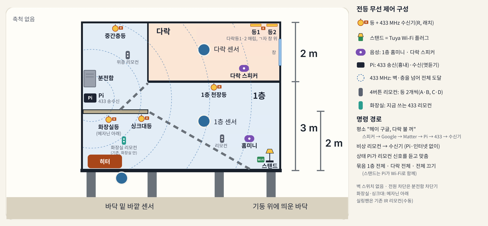

# 전등 음성·무선 제어 설계 (433 MHz + Pi + Google Home)

> 2026-11-17 시작 · 2026-11-19 확정판. 부품 주문 완료, Pi 코드는 부품 도착 전에 작성 예정.


> 배치(11-20 확정): 중간층등 = 중간층 천장 가운데 · 다락등1·2 = 다락 맨 오른쪽 천장 매립(ㄱ자, 창 위), **따로 켬(수신기 2)** · 1층 천장등 = 다락 바닥 가운데 아래 · 화장실등·싱크대등 = 메자닌 아래(왼쪽·맨 오른쪽) · 스탠드·홈미니·1층 리모컨 = 1층 오른쪽 · Pi = 메자닌 왼쪽 벽 분전함 아래. 벽 스위치 없음.
> 관련: [GOOGLE_HOME.ko.md](GOOGLE_HOME.ko.md)(Home Mini·Matter), [../HEATER.md](../HEATER.md)(동파 명령·떠날 때 점검).

## 1. 목표와 원칙

- **평소엔 말로**(1층 Home Mini + 다락 스피커), **문제가 생기면 433 MHz 리모컨으로** 전등을 켜고 끈다.
- 음성(Pi 경유)과 리모컨이 **같은 수신기**를 움직인다 → Pi·인터넷·Wi‑Fi가 죽어도 리모컨은 그대로 된다.
- **벽에 구멍·벽 안 배선 없음.** 농막에는 **벽 스위치가 없다** — 등 전원은 분전함 차단기에서 바로 오고, 켜고 끄기는 지금도 등에 든 수신기(IR·433)가 한다. 전원 차단은 분전함 차단기로만.
- 고장 나도 **불은 켤 수 있게**: 수신기를 빼고 선을 바로 이으면 "늘 켜진 등"(끄기는 차단기)이 된다. 벽 스위치가 없으므로 **같은 모델 예비 수신기**로 바로 바꾸는 것이 기본 대비.
- 안전이 중요한 기기(히터)는 433 MHz가 아니라 상태·전력이 보이는 Shelly가 맡는다.

## 2. 왜 433 MHz인가 (방식 비교)

| | IR | **433 MHz (EV1527)** | Wi‑Fi 플러그(Tuya·Shelly) |
|---|---|---|---|
| 송신기 위치 | 수신부가 **보여야** 함 | 벽·층을 넘어감, Pi 한 대로 집 전체 | 공유기 범위 |
| Pi·인터넷이 죽었을 때 | 기존 리모컨 | **리모컨이 수신기에 직접** | 기기 버튼만 |
| 상태 확인 | 없음 | 없음(Pi가 엿들어 보완) | 있음 |
| 데이터 사용 | 없음 | 없음 | 조금(클라우드) |
| 값 | — | 수신기 수천 원 | 1~3만 원 |
| 맞는 곳 | 실링팬(수동 유지) | **고정 전등** | 손 닿는 콘센트 기기(스탠드), 히터(Shelly) |

- **EV1527**: 리모컨마다 공장에서 새긴 20비트 주소(약 105만 가지) + 버튼 4비트(예: A=1000, B=0100). 무작위로 정해지면 두 리모컨이 겹칠 확률 약 100만분의 1. 등록 기관이 없어 MAC 주소처럼 유일이 보장되지는 않는다(도착 후 Pi로 기록해 겹침 확인).
- 같은 코드를 반복해서 보내므로 **누구나 엿듣고 흉내 낼 수 있다**(우리 Pi가 하는 일). 그래서 피해가 작은 전등에만 쓴다. 롤링 코드(자동차 키)는 흉내 낼 수 없어 이 설계에 맞지 않는다.
- PT2262류(납땜 점퍼 주소, 기본값이 같은 채로 팔림)와 롤링 코드 리모컨은 쓰지 않는다. 판매 표기 "learning code(EV1527), 433.92 MHz"를 확인.

## 3. 전등별 방식

| 이름(음성) | 방(Google Home) | 장치 | 리모컨 버튼 | 비고 |
|---|---|---|---|---|
| 1층 천장등 | 1층 | 새 실링팬 일체형 등(팬 리모컨·Tuya). 일체형이 아니면 433 미니 릴레이 | 팬 리모컨(일체형) 또는 1층 리모컨 A·B | 실링팬과 함께 교체 예정 |
| 싱크대등 | 1층 | 미니 릴레이 또는 소켓 어댑터 | 1층 리모컨 C·D | 전구 끼우는 등이면 어댑터 |
| 스탠드(책상) | 1층 | **남는 Tuya Wi‑Fi 플러그** | (Pi가 대신) | 433 아님. §7 |
| 화장실등 | 1층(메자닌 아래) | **기존 433 수신기 그대로**(켜기·끄기 버튼이 따로 있음, 11-20 확인) | **지금 쓰는 리모컨, 화장실 안에 둠** | Pi는 이 리모컨 코드를 엿듣고 흉내 냄. 습기: 수신기 교체 시엔 화장실 밖이나 방수함에 |
| 중간층등 | 1층 | 미니 릴레이 또는 소켓 어댑터 | 위층 리모컨 A·B | |
| 다락등1 / 다락등2 | 다락 | **이미 달린 2채널 Wi‑Fi+RF(Tuya) 컨트롤러**(11-20 확인: AC 90~250 V, 채널마다 10 A 무전압 접점 NO/NC/COM, 433.92 MHz + Wi‑Fi 2.4 GHz, 학습 버튼 ①②) → 채널1 = 등1, 채널2 = 등2 | 기존 다락 리모컨 + 위층 리모컨 C·D = **다락 전체**(두 채널에 같은 코드 추가 학습) | **양방향**: Pi가 Tuya 로컬로 상태를 알고 제어. 로컬 키 필요(다른 Tuya 플러그와 같은 절차), LTE 한도·고정 IP 등록. 새 미니 릴레이 불필요 |
| 실링팬 | 1층 | **1층 천장등과 함께 새 등 일체형 실링팬으로 교체 예정(11-20)** | 팬 자체 리모컨 | 권장: DC 모터 + LED 등 + **Tuya Wi‑Fi와 433 RF 리모컨 겸용** + 역회전 → Pi가 로컬로 등·팬 상태를 알고 제어, 겨울엔 역회전 저속으로 위아래 공기 섞기(지금 바닥 선풍기 대신). Tuya가 아니면 433 고정 코드·등 켜기/끄기 분리 확인. IR 전용·앱(BLE) 전용은 피함 |

- 수신기를 놓는 자리: **등 덮개 안**(벽 아님). 소켓형 전구 등은 **433 소켓 어댑터**를 끼우기만(배선 없음, LED 전구만, 높이 3~5 cm 늘어남, 디밍형 어댑터 피함, 켜기·끄기 분리 지원 확인).
- 덮개 안에 안 들어가면 등 옆 천장에 붙이고 짧게 연결.

## 4. 수신기: 433 미니 릴레이 2201A (주문함)

**사양**(매뉴얼, 한국어 포함): AC 85~240 V, 10 A, 대기 <5 mA, 433.92 MHz, 감도 >−97 dBm, **−30~+80 °C**, **리모컨 20개 기억**, 1527 학습 코드, 실내 30~50 m. 단자 `S1 S2 | L out L in | N in N out`. KC 인증은 없음(판매자 미제공) — 설치 원칙(§10)으로 보완.

**결선 A(우리 방식)**

```
전원 L ──→ L in        L out ──→ 등 L
전원 N ──→ N in        N out ──→ 등 N
S1·S2 : 비움 (결선 B = 벽 스위치 연결용, 벽 스위치가 없어 쓰지 않음)
```

- 들어오는 L과 N을 바꿔 꽂으면 등은 켜지고 꺼지지만 꺼져 있어도 소켓에 전기가 남는다 → 설치 뒤 **끈 상태에서 검전 드라이버로 소켓 확인**.
- 연결은 와고 221 커넥터로(고장 시 빼고 L·N을 바로 이으면 늘 켜진 등 — 예비 수신기로 바꿀 때까지 임시).

**작동 모드와 설정**

| 모드 | 동작 | 설정 | 사용 |
|---|---|---|---|
| 토글 | A 누를 때마다 켜짐↔꺼짐 | 학습 버튼 2번 → 3초 → 버튼 | ✗ 상태가 어긋남 |
| **래치** | **A = 켜기, B = 끄기** | **학습 버튼 3번 → 3초 → A → 3초 → B** | **✓ 사용** |
| 지연 | 켜면 5/10/15**분** 뒤 꺼짐 | 리모컨 버튼을 길게(표시등 1/3/6번) | ✗ 자동 끄기는 Pi가 |
| 초기화 | 등록 리모컨 모두 지움 | 학습 버튼 **8번** | |

- 매뉴얼: "한 리모컨의 모드를 바꾸기 전에 초기화" → 모드는 **리모컨(코드)별**로 기억되는 것으로 보임. 다른 코드 추가에는 초기화 불필요(도착 후 확인).
- 래치 모드는 버튼 2개 이상 리모컨이 필요. 4버튼 리모컨이면 A·B로 등 하나, C·D로 다른 등 하나.

## 5. 코드 방식

- **등마다 켜기·끄기 한 쌍만**: 수신기에는 그 등에 배정한 리모컨 버튼 쌍만 학습시킨다.
- **Pi는 흉내 낸다**: 수신 모듈로 리모컨 주소를 기록해 두고 같은 주소에 켜기/끄기 버튼값을 붙여 보낸다. 수신기는 Pi와 리모컨을 구분하지 못한다.
- **묶음(1층 전체·전체 끄기)은 Pi가 차례로 보낸다**(1초 안). Pi가 죽으면 리모컨으로 등마다.
- Pi 없이도 버튼 하나로 묶음을 쓰고 싶어지면 그때 묶음 코드를 해당 수신기들에 **추가 학습**(20개 기억, 다락 C·D처럼).
- 리모컨과 다른 버튼(벽 버튼 등)이 같은 코드를 내게 하려면 복제(copy)형 리모컨이 필요. 자가발전 벽 버튼은 코드가 고정. 지금은 벽 버튼 보류.
- 코드 파일 `~/smart-cabin/lights_codes.json`(Pi에만, **커밋 금지**, Pi 밖에도 백업).

## 6. 상태 맞추기

- 433 MHz는 한 방향이라 수신기는 상태를 알려 주지 않는다. Pi는 **마지막 명령**을 상태로 본다.
- Pi 수신 모듈이 리모컨 신호를 늘 듣는다 → 리모컨으로 켜고 꺼도 Pi·Google Home 상태가 따라온다(래치 모드라 켜기·끄기 코드가 달라 판별 가능).
- 신호가 가끔 한 번에 안 먹을 수 있어 송신은 **3번 반복**. 같은 등에 재명령이 잦으면 "수신기 약해짐" 알림.

## 7. 스탠드(Tuya 플러그)

| 방법 | 경로 | Pi 필요 |
|---|---|---|
| 음성("스탠드 켜", "1층 불 다 꺼") | Home Mini → Pi → Tuya(로컬) | 예 |
| 리모컨 "1층 전체"·"전체 끄기" | 버튼 → Pi가 엿듣고 → Tuya | 예 |
| 플러그 버튼 | 직접 | 아니요 |

- 묶음(1층·전체)에 스탠드를 넣는다. 433 등은 즉시, 스탠드는 약 1초 늦게.
- 스탠드 자체 스위치는 늘 켜 두고 플러그 버튼으로 조작. 전력 측정 플러그면 "켜짐인데 0 W" 알림.
- 금요일: 남는 Tuya 플러그 연결 → 고정 IP, `농막_기기` 표·LTE 하루 한도(5 MB) 등록, 전력 측정 여부 확인.
- 참고: Wi‑Fi + 433 겸용 플러그(전력 측정, 상태 기억)는 Pi 없이도 리모컨으로 끄고 상태도 보이는 콘센트 기기용. 필요해지면 검토.

## 8. 음성

```
1층 Home Mini ─┐                         ┌─ 433 송신(1층에서 다락까지)
               ├─ Google Home ─ Matter ── Pi(Matterbridge: 가상 전등 + 묶음)
다락 스피커 ───┘                         ├─ 433 수신(리모컨 상태 반영)
                                         └─ Tuya(스탠드)
```

- 스피커마다 **방** 지정 → 다락에서 "불 꺼"는 다락 등만.
- 다락 스피커: Nest Mini 2세대(Matter 허브, 마이크 개선) 또는 중고 Home Mini. 1층 음성이 된 뒤 구매.
- 음성은 인터넷 필요(Home Mini 한계). 끊기면 리모컨.
- Pi 음성 알림도 방에 맞게: 경보는 두 스피커, 시보는 사람이 있는 층.

## 9. Pi 하드웨어

**모듈**(주문함): STX882 송신 + SRX882 수신 키트(스프링 안테나 2) ×1, 433 MHz ASK 송수신 키트 ×1(둘째, 수신기 종류는 도착 후 확인). RXB6 디코딩판은 취소(디코더가 붙어 원시 신호를 못 받음).

| 모듈 핀 | Pi 4 물리 핀 | 신호 |
|---|---|---|
| STX882 VCC / GND / DATA | 2(5 V) / 6 / 11 | GPIO17 송신 |
| SRX882 VCC / GND / DATA | **1(3.3 V)** / 9 / 13 | GPIO27 수신 |
| SRX882 CS(사용) | 3.3 V에 연결 | 안 이으면 수신기가 꺼져 있음 |

- 수신기는 반드시 **3.3 V**(5 V면 DATA가 5 V → GPIO 손상).
- 안테나는 스프링 또는 17.3 cm 단선, Pi·금속에서 떼어 세로로.
- 모듈에 핀이 없으면 핀 헤더 납땜, 암-암 점퍼선 6가닥.
- 쓰지 않기로 한 것: CC1101 보드(SPI 설정이 복잡, 315 MHz 등 다른 주파수가 필요해지면 대안), CC1101 USB 시리얼 모듈(자기 패킷만 주고받아 리모컨 흉내 불가), TX118SA·RX480E 인코딩 키트(고정 코드 4개만, 원시 신호 불가).

## 10. 설치와 안전

1. **분전함 차단기를 내리고** 작업(벽 스위치가 없어 등 선은 늘 살아 있음).
2. 결선 A대로, 와고로 연결. 케이스 닫힌 상태로만 사용.
3. **LED 등에만**(정격 10 A보다 훨씬 작게), 덥고 막힌 곳 피하기. 다락은 통풍되는 쪽.
4. 설치 뒤 끈 상태에서 검전 드라이버로 소켓 확인 → 불 안 켜지면 정상.
5. 정전 뒤 수신기는 꺼진 상태로 시작하는 것이 보통 → Pi는 전원 복구를 알아채면(센서·플러그 재접속) 마지막 상태를 다시 보낸다(무인일 땐 끈 채 둠).

## 11. 수명과 대비

| 부품 | 예상 수명 | 약한 곳 |
|---|---|---|
| 433 수신 릴레이·소켓 어댑터 | 3~8년 | 전원부 콘덴서가 열에 약함 → **다락(여름 40 °C+)이 먼저** |
| 건전지 리모컨(CR2016) | 전지 1~3년 | 추위, 장기 방치 누액 |
| 자가발전 벽 버튼(도입 시) | 10만 회+ | 거의 없음 |
| Tuya·Shelly 플러그 | 5년+ | Pi 로컬 제어라 클라우드 영향 적음 |
| Home Mini(2017) | 기기는 됨 | 구글 지원 종료가 먼저 올 수 있음 |
| Pi | 기기는 됨 | SD카드 마모 → 예비 카드 이미지 |

대비: ① 고장 시 예비 수신기로 교체, 급하면 수신기 빼고 직결(늘 켜짐, 끄기는 차단기 — 벽 스위치 없음) ② 같은 모델 예비품(수신기 여유분, 리모컨 1) — 교체 후 Pi가 같은 코드로 재학습 ③ 코드 파일 백업 ④ 다락 열 피하기 ⑤ 리모컨은 층마다 1개만, 오래 비울 땐 전지 빼기 ⑥ 재명령 잦으면 알림.

## 12. 리모컨 배치

| 리모컨 | A·B | C·D | 둘 곳 |
|---|---|---|---|
| 1층 | 1층 천장등 | 싱크대등 | 1층 정한 자리(고리·자석) |
| 위층 | 중간층등 | 다락 전체 | 다락 계단 |
| 다락(기존) | 다락등1 | 다락등2 | 다락 |
| 화장실(기존) | 화장실등 켜기·끄기 | — | 화장실 안 |

- 주문한 4버튼 리모컨 3개(세트 2 + 단품 1)를 모두 씀 → **예비 리모컨은 없음**. 하나 잃어버려도 Pi·음성으로 쓰고, 필요하면 같은 리모컨 1개 추가(약 3,500원).
- 미니 릴레이는 8개 중 2~3개 사용(싱크대·중간층, 실링팬이 일체형이 아니면 1층 천장) — 다락은 기존 Tuya 2채널, **5~6개 예비**. 새로 산 4버튼 리모컨 3개 중 다락용이 빠지므로 **1개 예비**.

- 위 버튼 = 켜기, 아래 버튼 = 끄기로 통일. 뒷면에 등 이름 스티커.
- 리모컨 표기(A/B, ON/OFF)는 상관없다 — 켜기·끄기는 학습 순서로 정해진다.

## 13. 구매 현황

**주문함 (2026-11-18~19)**

| 품목 | 수량 | 금액(원) |
|---|---|---|
| 433 미니 릴레이 2201A, 4수신기+4버튼 리모컨 세트 | 2 | 37,000 |
| 4버튼 433 리모컨(EV1527) 단품 | 1 | 3,500 |
| (위 두 건 할인 후) | | 39,200 |
| STX882+SRX882 키트 | 1 | 5,650 |
| 433 ASK 송수신 키트(둘째) | 1 | 4,113 |

**있는지 확인할 것**: 암-암 점퍼선, 검전 드라이버, 와고 221(2·3구 10개쯤), 납땜 인두, 예비 microSD 32 GB(Pi 이미지, 권장), CR2032(센서 예비).

**금요일 뒤에 정할 것**: 433 소켓 어댑터(전구 끼우는 등만), 미니 릴레이 추가(기존 수신기가 토글 전용이면 — 여유분으로 충분할 가능성 큼), 다락 스피커(음성 단계), 자가발전 벽 버튼(보류).

**쓰지 않기로 한 것**: Broadlink 등 IR 허브(가려지면 안 됨), 중성선 없는 벽 스위치형 수신기(벽 작업, LED 깜빡임), DC 12 V 수신기(전원 별도), 30 A 펌프용 모듈(전등에 과함 — 마당 펌프·투광등에는 적합), 무전압 접점형 미니(점퍼 배선 필요, 기억 10개 — 2201A가 배선이 쉬움).

## 14. 금요일(11-20) 현장 확인

1. 등 사진: 1층 천장, 싱크대, 중간층, 다락 2, 화장실 — **덮개 안 공간·전선·전구 끼우는 방식**이 보이게.
2. 화장실·다락 기존 리모컨 사진(버튼 수), 등 쪽 수신기에 학습 버튼이 있는지.
3. 남는 Tuya 플러그를 스탠드에 연결(§7).
4. Pi 위치와 다락·화장실 거리(송신 도달 예상).

## 15. 구현 순서

1. **(지금, 하드웨어 없이)** Pi `lights` 모듈: EV1527 인코더·송신(pigpio, 3회 반복), 수신·해독·기록, 학습 명령(사람이 학습 버튼 3번 → Pi가 3초 간격으로 켜기·끄기), 상태 파일, 묶음, 모의 시험.
2. 명령: 텔레그램·시트·문자 `불 켜 <이름>` / `불 꺼 전체` / `불 상태` / `불 학습 <이름>`. 떠날 때('동파') 모두 끄기.
3. **(모듈 도착)** Pi에 연결 → 모든 리모컨 코드 기록·겹침 확인 → 책상 위에서 수신기 1개로 래치 모드·Pi 흉내·코드 추가 시험.
4. 등에 설치(§10).
5. Matterbridge 가상 전등 → Google Home 방 배정 → 1층 음성 → 다락 스피커.
