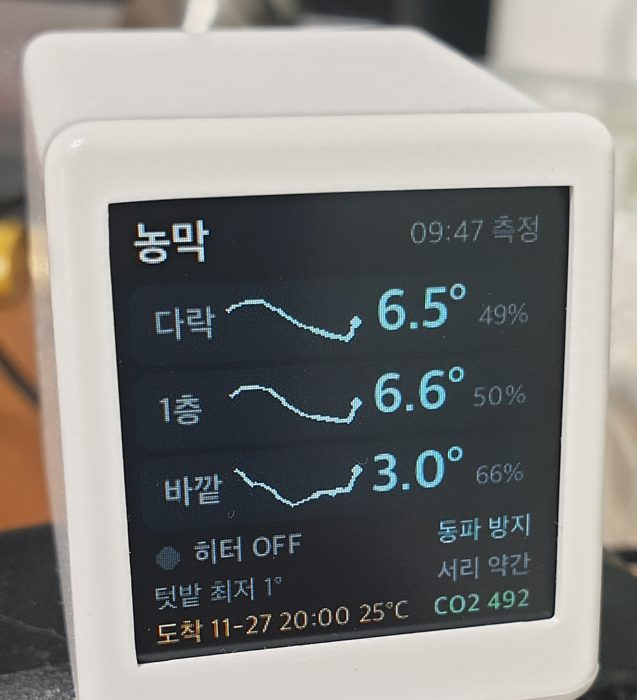
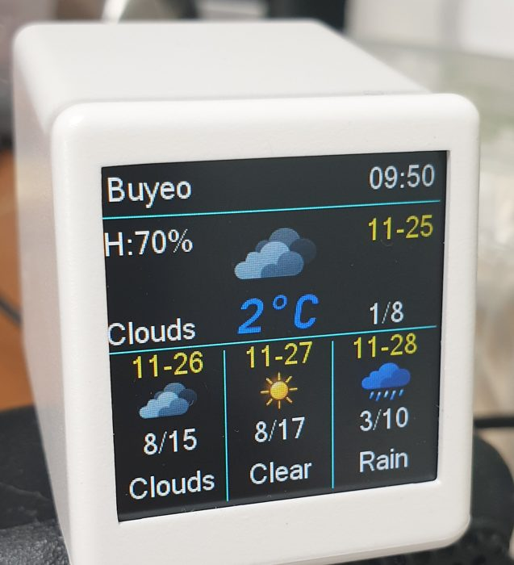
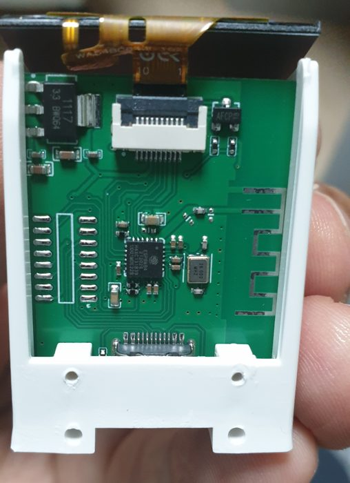
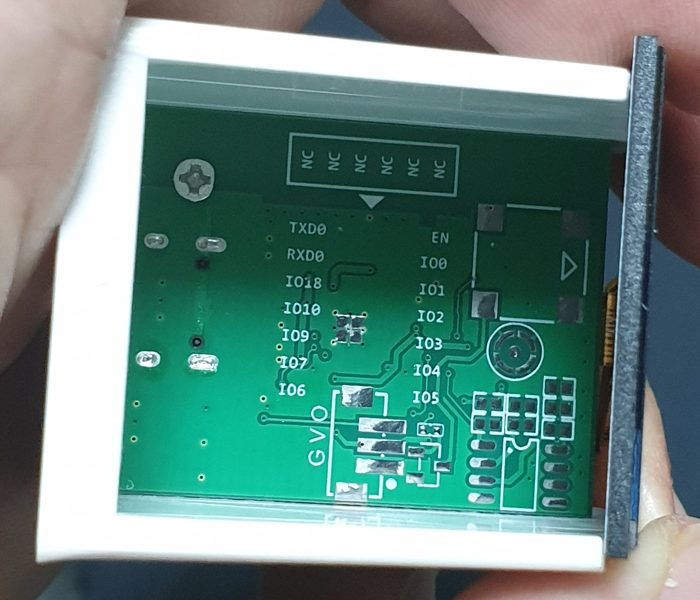

# smartclock — 1.54인치 스마트 시계에 농막 상태 띄우기

알리에서 산 정육면체 "Smart Weather Clock"(ESP32-C2, 240×240 LCD)에 농막 상태를 그림으로 그려 올린다.
**펌웨어는 그대로** 두고, 시계 웹 UI의 사진 업로드 API만 쓴다. 시계가 같은 LAN에 있으면 되므로
집·사무실 책상에 두고 맥·Pi·윈도우 중 같은 Wi‑Fi에 있는 컴퓨터가 5분마다 갱신하는 용도.

```
Pi(농막) ──쓰기──> 구글 시트 '농막_현재' ──doGet ?q=now──> 맥·Pi·윈도우 smartclock_push.py ──/photo/upload──> 시계
```

화면: 1층·다락·바깥 온도/습도와 **최근 24시간 온도 꺾은선**(라벨과 온도 사이), 히터 ON/OFF·모드, 텃밭 예상 최저·서리, 도착 예약, CO2(1000/2000ppm 색 구분),
오른쪽 위 "HH:MM 측정"(30분 넘게 기록이 없으면 빨간 "지연").

| 농막 화면 | 기본 날씨 화면 | 내부 기판 | 뒷면 패드 |
|---|---|---|---|
|  |  |  |  |

(2026-11-25 09:47, 책상 위. 사진은 발표자료 16쪽에도 실림.)

## 파일

| 파일 | 내용 |
|---|---|
| `smartclock_push.py` | 그림 생성 → 업로드 → 이전 `sc_*` 삭제 → 슬라이드쇼 체크. 최소 5분 간격, 그림이 같으면 생략 |
| (그래프) | 웹앱이 시간별 기록을 주면 그것을, 아니면 5분마다 받은 값을 `.smartclock_hist.json`에 쌓아 사용 |
| `farm_screen.py` | `농막_현재` 행 리스트 → 240×240 화면 (1열 라벨로 찾음, Pi의 gspread `get_values()` 결과도 그대로 사용 가능) |
| `farm_webapp.json.example` | `secrets/farm_webapp.json` 형식 (웹앱 URL + 토큰) |
| `kr.ryufarm.smartclock.plist.example` | 맥 launchd 5분 작업 |
| `run_windows.cmd` | 윈도우에서 손으로 한 번 실행(결과 창 표시). 자동은 아래 schtasks |
| `test_smartclock.py` | 여러 컴퓨터 겹침 방지·글꼴 테스트 |

## 설치 — 공통 (맥·Pi/리눅스·윈도우)

같은 스크립트가 세 곳에서 돈다. 여러 대가 동시에 켜 두어도 된다: 시계에 올라간 `sc_MMDD_HHMM_<그림해시6>.jpg`
이름을 보고 **다른 컴퓨터가 4분 안에 올렸거나 같은 그림이 이미 있으면 건너뛴다**(플래시 마모 방지).
시계와 **같은 네트워크(Wi‑Fi)** 에 있는 컴퓨터만 올릴 수 있고, 아니면 "시계에 닿지 않음" 한 줄만 남기고 끝난다.

1. 시트 Apps Script(`sheets/Code.gs` v16 이상 — `?q=now`가 현재값과 `최근5일_시간별`을 함께 줌)에서 **프로젝트 설정 → 스크립트 속성**에 `CLOCK_TOKEN` 추가(임의의 긴 문자열),
   **배포 관리 → 기존 웹앱 → 새 버전**으로 배포. 시계와 Pi가 **서로 다른 배포**를 쓰므로 Code.gs를 바꿀 때는 두 배포 모두 새 버전으로 올린다(2026-11-25 Pi 쪽만 Version 20에 남아 `mode:pred`가 안 먹던 일).
2. 이 폴더에 `secrets/farm_webapp.json`을 만든다(`farm_webapp.json.example` 복사 → URL·토큰, 선택으로 시계 주소 `host`). **저장소에 올리지 않는다**(gitignore).
3. 시험: `--farm-url --force`로 한 번 올리고 `--list`로 확인.

시계 주소 우선순위: `--host` > 환경변수 `SMARTCLOCK_HOST` > `secrets/farm_webapp.json`의 `host` > 기본 192.168.0.156(DHCP라 바뀔 수 있음 — 공유기에서 고정 권장).
한글 글꼴은 맥 Apple SD 고딕 → 리눅스 Noto CJK·나눔 → 윈도우 맑은 고딕 → `fc-match` 순으로 찾고, `SMARTCLOCK_FONT=글꼴파일`로 직접 지정할 수 있다.

### 맥
```
pip3 install pillow
mkdir -m 700 secrets && cp farm_webapp.json.example secrets/farm_webapp.json   # 편집
python3 smartclock_push.py --farm-url --force && python3 smartclock_push.py --list
```
자동 갱신: plist 예시의 `<PYTHON3>`·`<REPO>`를 바꿔 `~/Library/LaunchAgents/`에 복사 후 `launchctl load …`.
처음 실행 때 macOS가 로컬 네트워크 접근을 물으면 허용. 로그인 항목에 "python3"로 보이는 것이 이 작업.

### 라즈베리 파이 · 리눅스
```
sudo apt install -y python3-pil fonts-noto-cjk
cd ~/smart-cabin/smartclock
mkdir -m 700 secrets && cp farm_webapp.json.example secrets/farm_webapp.json && nano secrets/farm_webapp.json
python3 smartclock_push.py --farm-url --force && python3 smartclock_push.py --list
crontab -e   # 아래 한 줄
*/5 * * * * cd ~/smart-cabin/smartclock && python3 smartclock_push.py --farm-url --log logs/push.log
```
- 농막 Pi는 시계가 **농막 Wi‑Fi(Ryufarm)에 있을 때만** 닿는다(집 책상의 시계는 집 컴퓨터가 맡는다).
- 농막 Pi가 웹앱을 5분마다 읽으면 LTE를 하루 1~2 MB(한 달 수십 MB) 쓴다. 시계를 농막에 둘 때는 Pi의 로컬 값(`latest.json` 등)으로 그리는 방식이 더 낫다(아직 없음 — 필요하면 추가).

### 윈도우
1. [python.org](https://www.python.org/downloads/)에서 Python 3 설치(설치 화면에서 "py launcher" 포함). 명령 프롬프트에서 `py -3 -m pip install pillow`.
2. 저장소를 받은 뒤(`git clone` 또는 ZIP) `smartclock` 폴더에서 `secrets\farm_webapp.json`을 만든다(예시 복사 후 메모장으로 편집).
3. 시험: `run_windows.cmd` 더블클릭(창이 뜨고 결과를 보여 줌) → `py -3 smartclock_push.py --list`.
   처음에 Windows 방화벽이 Python의 네트워크 접근을 물으면 **개인 네트워크** 허용.
4. 자동 갱신(창 없이 5분마다) — `smartclock` 폴더에서 명령 프롬프트로:
   ```
   schtasks /Create /TN "SmartClock" /SC MINUTE /MO 5 /F /TR "pyw -3 \"%CD%\smartclock_push.py\" --farm-url --log \"%CD%\logs\push.log\""
   ```
   끄기 `schtasks /Delete /TN "SmartClock" /F`, 로그는 `logs\push.log`. 노트북이 절전이면 그동안은 갱신되지 않는다.

기타: `--title/--line`(글자 화면), `--image`(사진 240×240 자르기), `--exclusive`(다른 사진 슬라이드쇼에서 빼기),
`--dry-run`(jpg만 저장), `--log 파일`(출력을 파일에 덧붙임). 테스트 `python3 -m unittest test_smartclock`.

## 시계 웹 API (기존 펌웨어, 인증 없음)

| 용도 | 호출 |
|---|---|
| 목록·용량·슬라이드 간격 | `GET /photo/list` → `{files:[{name,size,enabled}], total, used, interval}` |
| 업로드 | `POST /photo/upload` multipart 필드 `file` (240×240 JPG/PNG, GIF ≤240×240) |
| 삭제 | `GET /photo/delete?name=…` |
| 슬라이드쇼 포함 | `GET /photo/toggle?name=…&state=0\|1` |
| 슬라이드 간격 | `GET /photo/interval?val=초` |
| 테마 | `GET /theme/list`, `GET /theme/toggle?id=…&state=0\|1` (0 Classic, 1 Weather, 2 Photo, 3 Dial, 4 Simple, 5 Weather forecast, 6 Flip Clock) |

## 장비 메모

- 칩 ESP8684 H4(ESP32-C2), 플래시 4MB, 수정 26MHz. 화면 ST7789 추정. USB-시리얼 칩 자리가 비어 USB-C는 전원 전용.
- 뒷면 패드 TXD0/RXD0/EN/IO0~10/IO18/G/V. 다운로드 모드 = IO9를 GND에 두고 리셋.
- **OTA 금지**: 제조사 "Firmware github"(JUZIPi-tech/SD_PRO)의 `SDP_*.bin`은 다른 모델용. 이 시계는 `SDC2*` 파일만 받음.
- 펌웨어를 바꾸려면 3.3V USB-시리얼로 먼저 `esptool --chip esp32c2 read_flash 0 0x400000 backup.bin` 통째 백업.
- 저장공간 약 2.4MB, 그림 1장 약 12KB. 5분 간격 + 변화 없으면 생략이라 플래시 마모는 작다.
- 배터리용으로는 부적합(Wi-Fi 상시 + 백라이트 ≈ 0.5W). 여러 곳에 배터리로 붙이려면 전자종이(ESL/OpenEPaperLink 등)가 맞다.

## 비밀 정보

웹앱 URL·토큰은 `secrets/`(gitignore)와 스크립트 속성에만. 시계 설정 화면의 OpenWeatherMap 키, Wi-Fi 이름·비밀번호,
MAC 주소는 이 저장소에 쓰지 않는다.
